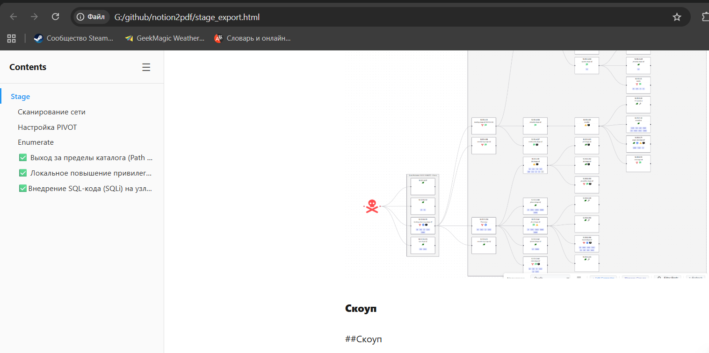

# notion-dump

Export an entire public Notion page — including all nested subpages, text, and images — into a single offline HTML document.

No API key required. Works with any `*.notion.site` link.



## Why

Notion's built-in export is slow, lossy, and splits everything into separate files. `notion-dump` gives you **one HTML file + an images folder** that you can open locally, print to PDF, or archive.

## Quick start

```bash
pip install requests
python notion_export.py "https://your-workspace.notion.site/Page-Name-abc123def456" output.html
```

This creates:
- `output.html` — the full document with all pages rendered in order
- `images/` — downloaded images referenced by the HTML

## Features

- Recursively crawls all nested subpages from a root page
- Downloads all images to a local folder (8 concurrent threads)
- Renders text, headings, code blocks, lists, toggles, callouts, quotes, tables, bookmarks, embeds, and more
- Preserves rich text formatting (bold, italic, strikethrough, code, colors, links)
- **Interactive sidebar table of contents** — mirrors the full page hierarchy, highlights current section on scroll, collapsible
- Streams HTML to disk — works on large wikis without running out of memory
- Clean, readable output with print-friendly CSS (TOC hidden when printing)
- Zero dependencies beyond `requests` (Python 3.10+)

## Supported block types

| Block type | Rendered as |
|---|---|
| Text | `<p>` with rich formatting |
| Heading / Sub-heading | `<h2>` / `<h3>` / `<h4>` |
| Image | `` (downloaded locally) |
| Code | `<pre><code>` |
| Bulleted list | `<ul>` |
| Numbered list | `<ol>` |
| To-do | Checkbox + text |
| Toggle | `<details>` / `<summary>` |
| Callout | Styled div with icon |
| Quote | `<blockquote>` |
| Divider | `<hr>` |
| Bookmark | Link |
| Table | `<table>` |
| Video / Embed | Link placeholder |
| Column layout | Flex columns |

## Limitations

- Only works with **public** Notion pages (no authentication)
- Uses Notion's internal API, which may change without notice
- Very large exports (1000+ pages) may take several minutes due to rate limiting

## License

MIT
